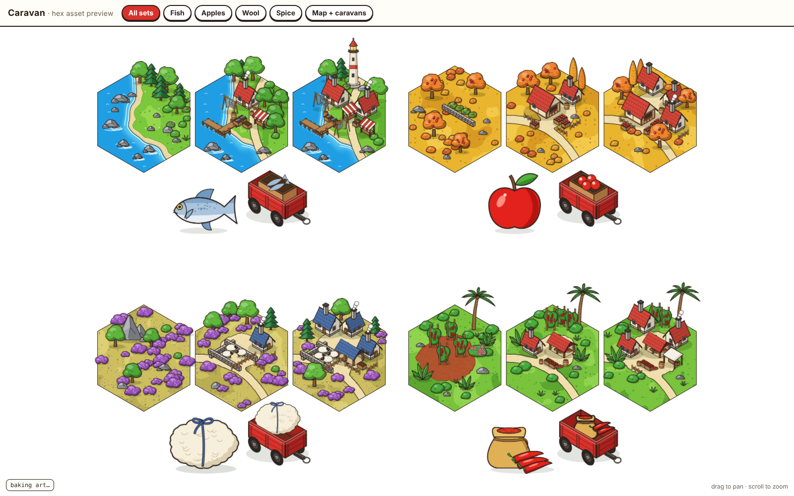

# Caravan

Towns sit on hexes, each making one thing and needing another. You draw roads, and caravans run them on their own.

This repo currently holds the **hex asset preview**: the 2D Three.js rendering framework for the hand-inked ligne-claire look, with four goods families in three growth stages, goods icons, caravan wagons, and a joined map where wagons bounce along the roads.



## Run it

```sh
npm install
npm run build          # bundles src/ -> dist/main.js and dist/caravan-preview.html
open index.html        # or open dist/caravan-preview.html (single self-contained file)
```

Tabs switch between the Fish, Apples, Wool and Spice sheets and the map view. Drag to pan, scroll or pinch to zoom.
URL options: `?set=0..3`, `?map`, `?zoom=x,y,height`, and `?noterrain` / `?nosprites` for performance A/B checks.

## Layout

| Path | What it is |
| --- | --- |
| `src/art/ink.js` | Drawing kit: uniform ink contour, cel shading, scalloped blobs, isometric helper |
| `src/art/nature.js`, `buildings.js`, `goods.js` | Procedural sprites: flora, rocks, buildings, props, icons, wagons |
| `src/art/sprites.js` | Sprite registry (names, variants, bake scale) |
| `src/art/atlas.js` | Bounds-recording bake + shelf packer into one atlas |
| `src/engine/hex.js` | Pointy-top axial hex math and the per-hex data block |
| `src/engine/terrain.js` | Terrain shader: biome cel bands, tufts, blended coasts, foam, inked roads and yards, hex outlines |
| `src/engine/spriteLayer.js` | One instanced, y-sorted, premultiplied draw per sprite layer, with bounce |
| `src/tiles.js` | Tile compositions: 4 families x 3 stages, seeded flora scatter |
| `src/mapview.js` | Tiles joined on one map, plus caravans following the road curves |
| `dev/` | Build, packaging, atlas debug page, headless screenshot script |

World units are reference-sheet pixels: one hex is 490 units wide.
